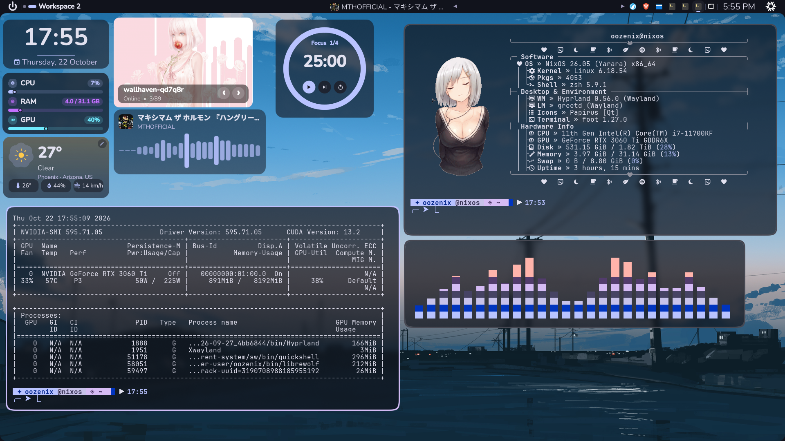
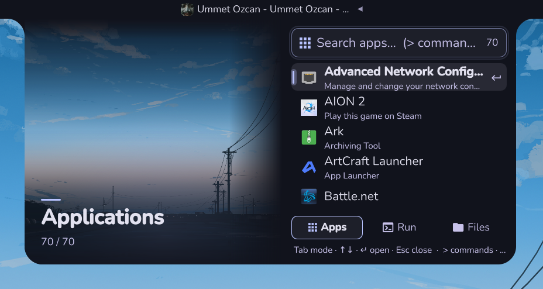
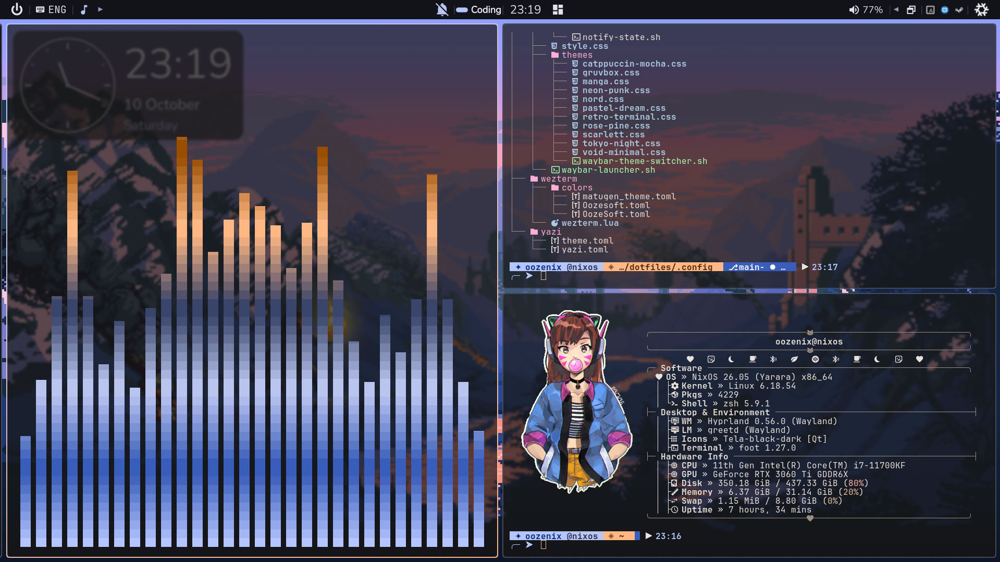
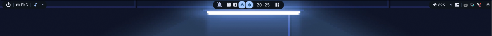
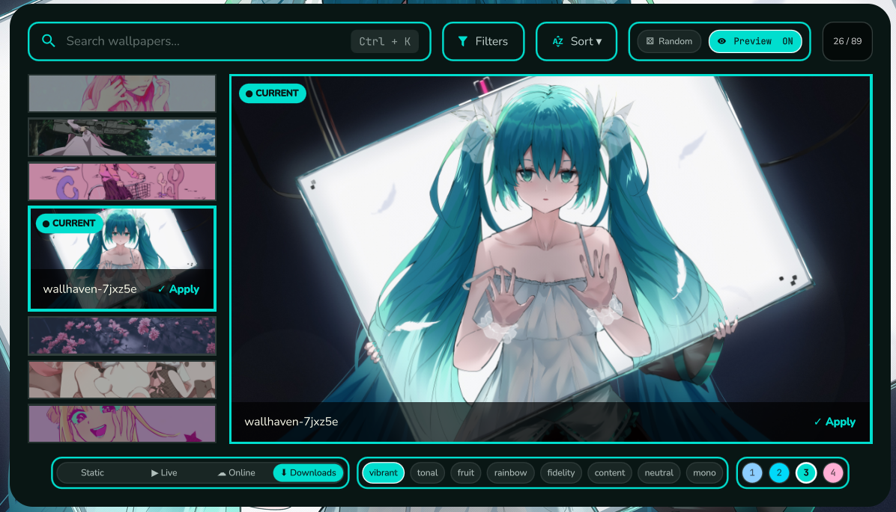
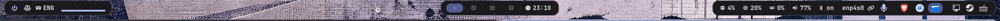
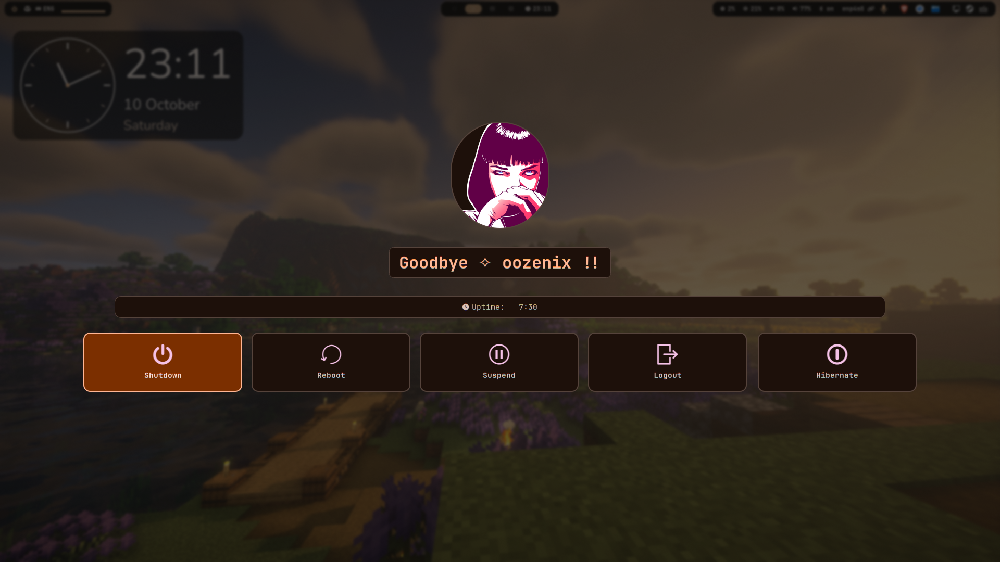

# Oozenix Dotfiles Beta

Personal dotfiles for a **Hyprland** Wayland desktop on **NixOS** (main target) and **Arch Linux**, built around **OozeShell**: a Quickshell / Qt6 shell that replaces the bar, launcher, notifications, lock screen, wallpaper selector, dock, media controls, power menu and most system panels.

> **Before you start**
> * These are my personal settings. Expect to adjust monitors, GPU variables, keyboard layout and paths. The Hyprland config targets an NVIDIA machine.
> * The Hyprland config is Lua (`hyprland.lua`), which needs **Hyprland 0.55 or newer**.
> * On NixOS, the easiest path is to pair these dotfiles with [nix-home](https://github.com/shizukutakahashi55-del/nix-home), which already provides every package, service and font.

---

## Contents

[Supported systems](#supported-systems) · [Install](#install) · [What gets linked](#what-gets-linked) · [Dependencies](#dependencies) · [OozeShell](#oozeshell) · [IPC](#controlling-oozeshell-ipc) · [Theming and wallpapers](#theming-and-wallpapers) · [Waybar](#waybar) · [Optional components](#optional-components) · [Updating](#updating) · [Uninstall](#uninstall) · [Troubleshooting](#troubleshooting) · [Repository layout](#repository-layout)

---

## Supported systems

| System | Support |
| --- | --- |
| **NixOS** | Main target. Package search uses `nix-search`. |
| **Arch Linux** | Supported. The installer installs the dependencies. Package search uses pacman + AUR. |
| **Other distros** | Not supported. The installer takes the NixOS branch and writes `NixOSInstallation.md` with the dependency list to adapt by hand. |

---

## Install

**1. Clone into `~/dotfiles`** (the installer expects exactly that path):

```bash
git clone https://github.com/shizukutakahashi55-del/dotfiles-nix.git ~/dotfiles
cd ~/dotfiles
```

**2. Review what is machine specific:** monitors (`hypr/modules/hardware`), NVIDIA variables, keyboard layout, startup apps, keybinds and terminal. Paths use `$HOME`, so no username edits are needed.

**3. Run the installer as your normal user** (it refuses to run as root and uses `sudo` only where needed):

```bash
chmod +x install-oozenix.sh
./install-oozenix.sh
```

**4. Start OozeShell.** Hyprland starts it from its startup module; to start it by hand:

```bash
quickshell -c OozeShell
```

### What the installer does

It is interactive and asks before anything invasive. Every system:

1. Extracts `OozeShell.zip` into `.config/quickshell/OozeShell`. A previous copy is moved to `~/.local/share/oozeshell/backups/`, never deleted.
2. Creates the symlinks and sets executable permissions.

Arch adds: AUR helper check (offers `paru`), optional `pacman -Syu`, base dependencies (retrying one by one if a batch fails), `quickshell` and `awww`, a terminal of your choice, optional services, optional Waybar, legacy tools and extras, optional Suwayomi, the optional OozeWalls engine, and the NVIDIA / Electron variables in `env.lua`.

Other distros add: the `NixOSInstallation.md` file and the `nix-rofi` link. No packages are installed.

Block-by-block details are the comments inside `install-oozenix.sh`.

---

## What gets linked

Everything is a symlink into `~/dotfiles/.config`, so editing `~/.config/hypr/` edits the repository directly.

| Always | Only if you say yes to "legacy tools" | Only on non-Arch |
| --- | --- | --- |
| `alacritty` `cava` `dolphin` `fastfetch` `foot` `ghostty` `hypr` `kitty` `matugen` `nvim` `quickshell` `rofi` `wezterm` `yazi` `waybar` `starship.toml` `.zshrc` | `swaync` `swayosd` | `~/.local/bin/nix-rofi` |

Also linked: `niri` and `mango` (when present), and `VK-Th/themes` → `~/.config/vesktop/themes`.

| Situation at the target | Result |
| --- | --- |
| Nothing there | Link created. |
| Link to the right place | Left alone. |
| Link to somewhere else | Replaced. |
| Real file or directory | Asks to move it to `<target>.bak-<timestamp>`. Answer `n` to skip that item. |

`git-update` is not linked automatically:

```bash
chmod +x ~/dotfiles/git-update
ln -s ~/dotfiles/git-update ~/.local/bin/git-update
```

---

## Dependencies

Arch: handled by the installer. NixOS: use nix-home or `NixOSInstallation.md`.

| Group | Packages |
| --- | --- |
| Compositor | `hyprland` (≥ 0.55), `hyprpaper`, `hypridle`, `hyprlock`, `hyprpolkitagent`, `hyprshot`, `hyprsunset`, `hyprshutdown`, `hyprsysteminfo`, `xdg-desktop-portal` (+ `xdg-desktop-portal-hyprland`, `xdg-desktop-portal-gtk`) |
| Shell | `quickshell`, Qt6 (`qt6-base`, `qt6-declarative`, `qt6-svg`, `qt6-shadertools`, `qt6ct`) |
| Audio | `pipewire`, `pipewire-pulse`, `wireplumber`, `pavucontrol`, `qpwgraph` |
| Hardware | `brightnessctl`, `power-profiles-daemon`, `upower` |
| Network / Bluetooth | `networkmanager` + applet, `bluez`, `bluez-utils`, `blueman` |
| Media | `playerctl`, `mpv`, `mpvpaper`, `ffmpeg`, `cava` |
| Wallpaper / theming | `awww`, `imagemagick`, `matugen` |
| Utilities | `socat`, `jq`, `wl-clipboard`, `cliphist`, `xdg-utils`, `libnotify`, `wtype`, `wev`, `grim`, `slurp`, `fastfetch`, `tmux`, `curl`, `python`, `rofi` |
| Fonts | JetBrainsMono Nerd Font, Symbols Nerd Font Mono |
| Terminal | one of foot, kitty, alacritty, wezterm, ghostty |

Optional: `waybar`, `swaync`, `swayosd`, `wlogout`; `nix-search` (NixOS package search); pixel fonts for the CoOzey theme (Pixelify Sans, Jersey 10, Silkscreen, VT323, DotGothic16; NixOS snippet in `OozeShell/Tools/fonts/fonts.nix.example` — on Arch only Silkscreen, VT323 and DotGothic16 are installed, so Pixelify Sans and Jersey 10 fall back to the Nerd Font); an extras bundle on Arch (yazi, neovim, starship, gaming tools and more); Niri or MangoWM, which OozeShell detects on its own (Niri works fine, still working on MangoWM I'm a bit limited to work on mango with v0.17.4 on NixOS).

---

## OozeShell

**Modes:** *Bar* (top, bottom, left or right, optionally floating), *Islands* (no bar background, popups grow from their island) and *Pill + Dashboard* (compact pill that opens a full dashboard). Two styles, **OozeSoft** and **CoOzey**, each in light and dark, and some extra palettes.

**Main features**

* Taskbar, tray, workspaces, clock, privacy indicators, battery, brightness, and a floating **Dock**.
* **Dashboard**: overview, performance, audio, calendar, media, power, quick access.
* **Launcher** (apps, windows, run, files, calculator, tmux sessions) and **Overview** with live window previews.
* **Package search**: `nix-search` on NixOS, pacman + AUR on Arch, with an Installed view (`Ctrl+L`) and uninstall (`Ctrl+R`) on Arch.
* Notification center with Do Not Disturb, **Agenda** with to-dos and alarms, clipboard history.
* **Wallpaper selector** with static and live video wallpapers, palette extraction through Matugen.
* Media (MPRIS), audio menus and **OozeAudio** routing, network, Bluetooth and power-profile menus.
* **OozeLock**: native lock screen (`ext-session-lock-v1` + PAM), replaces `hyprlock`.
* OSDs, power menu, screenshots, monitor selector and editor, keybinds cheatsheet.
* **Advanced Settings** with a searchable registry; appearance controls generate Hyprland theme files.
* Languages: English, Español.

**Default keybinds:** `SUPER+I` keybinds, `SUPER+L` monitor picker, `SUPER+G` language picker, `SUPER+U` package search. The source of truth is `hypr/modules/input/keybinds.lua`.

**Sanity check after editing the shell:**

```bash
cd ~/.config/quickshell/OozeShell
bash Tools/check.sh
```

---

## Controlling OozeShell (IPC)

```bash
quickshell ipc -c OozeShell call <target> <function> [args]
```

| Target | Functions |
| --- | --- |
| `bar` | `position top\|bottom\|left\|right`, `togglePosition`, `floating true\|false`, `toggleFloating`, `islands`, `pill`, `togglePill`, `get` |
| `corners` | `toggle`, `set true\|false`, `get` |
| `settings` | `toggle`, `open`, `close`, `get` |
| `theme` | `mode light\|dark`, `toggle`, `style cozy\|soft`, `styleGet`, `softfont` |
| `appearance` | `toggle`, `get`, `set <key> <value>` |
| `launcher` | `toggle`, `open <apps\|windows\|run\|files>`, `close` |
| `nixsearch` | `toggle`, `open <query>`, `installed` (Arch), `close` |
| `overview`, `agenda`, `powermenu`, `clipboard` | `toggle`, `open`, `close` |
| `menu`, `network`, `bluetooth`, `mpris`, `keybinds` | `toggle` |
| `audio` | `toggle`, `raise`, `lower`, `mute`, `micToggle`, `micRaise`, `micLower` |
| `notify` | `toggle`, `show <text>`, `toggleDnd`, `enableDnd`, `disableDnd`, `isDnd`, `clear` |
| `toggleWalls` | `handle` |
| `screenshot` | `areaCopy`, `areaSave`, `fullSave` |
| `lock` | `lock`, `locked` |
| `monitor` | `set <name\|auto>`, `get`, `current`, `list`, `togglePicker` |
| `lang` | `set <code>`, `get`, `list`, `togglePicker` |
| `keyboardlayout` | `next` |
| `caps`, `layoutosd` | `show` |

The package search target is called `nixsearch` on every system, so the same keybind works everywhere.

---

## Theming and wallpapers

Matugen generates colors from the current wallpaper and themes Hyprland, OozeShell, Waybar, terminals, Cava, Starship, Yazi, Vesktop and more.

```text
~/.config/matugen/config.toml      main configuration
~/.config/matugen/templates/       one template per app
```

Wallpapers are read from `~/Pictures/Wallpapers` (create it if missing). Static ones use `awww`; video ones use `mpvpaper`, and Matugen takes the palette from one extracted frame. The lock screen wallpaper is set in **Advanced Settings → General**.

---

## Waybar

OozeShell can use Waybar instead of its own bar: **Settings → Bar → Waybar** (horizontal bar only, not Pill). The option is disabled until `waybar` is installed.

How it is wired:

* `waybar/waybar-launcher.sh` is started by OozeShell and keeps a single Waybar alive. It picks the config for the active compositor (`config.jsonc`, `config-niri.jsonc` or `config-mango.jsonc`), restarts Waybar if it crashes, and shuts it down when you switch back to the OozeShell bar.
* On every wallpaper change, Matugen rewrites `waybar/style.css` and runs `matugen/scripts/reload-waybar.sh`, which only sends `SIGUSR2` to that Waybar so it reloads the colors in place. It never starts or kills Waybar itself.
* Each reload is logged in `$XDG_RUNTIME_DIR/waybar-ctl/reload.log`.

**Static themes** live in `waybar/themes/` and are applied with `waybar/themes/waybar-theme-switcher.sh`. They write the same `style.css` as Matugen, so Matugen overwrites them on the next wallpaper change. To keep a static theme, disable `[templates.waybar]` in `~/.config/matugen/config.toml`.

---

## Optional components

**Native animation core (C++).** OozeShell works without it. With it, animation math runs natively.

```bash
bash ~/.config/quickshell/OozeShell/Tools/build-native.sh
```

The installer offers to build it. Quickshell finds it through `QML_IMPORT_PATH`, which the installer adds to `env.lua`; log out and back in once. When active, the OozeShell log says `[theme] núcleo nativo: activo`. Needs `cmake` and a C++17 compiler. On NixOS use `nix-shell native/shell.nix --run 'bash Tools/build-native.sh'`, and make sure that shell's Qt is the same one `quickshell` uses.

**Suwayomi (Arch).** The installer can install `suwayomi-server-bin`, create a `tachidesk.service` user unit and a `tachidesk` command (`start|stop|restart|status|enable|disable`) in `/usr/local/bin`. OozeShell controls it from **Settings → Services**. It does not start at boot. If you skip it, the steps are written to `SuwayomiSetup.md`.

**OozeWalls (optional live-wallpaper engine).** The installer can build `OozeWalls/` (Rust) and install `oozewalls` and `oozewalls-gui` in `~/.local/bin`, plus a launcher entry. On Arch it also installs the runtime libraries and `cargo`/`rustc`; the folder picker of the GUI needs `xdg-desktop-portal` and a FileChooser backend. On NixOS the same engine ships as a Home Manager module (`OozeWalls/hm-module.nix`). Pick it in **Settings → Wallpapers** (static and live engine `oozewalls`). OozeShell restores the saved wallpaper on start, so no extra `exec-once` is needed.

---

## Updating

```bash
cd ~/dotfiles
git status && git diff
```

* Keep local changes: commit or `git stash`, then `git pull` (and `git stash pop`).
* Drop a local change: `git checkout -- <file>`, then `git pull`.
* Discard everything local (**deletes all uncommitted work**): `git fetch origin && git reset --hard origin/main`.

Then re-run `bash install-oozenix.sh`. In update mode it replaces the OozeShell folder (the old one goes to the backups directory), and tells git to ignore `hypr/modules/appearance/autogen`, which OozeShell regenerates. On Arch it also re-applies the `env.lua` changes, which will show as local modifications.

---

## Uninstall

Removing a symlink does not delete the repository. Check the target first (`readlink -f ~/.config/hypr`), then:

```bash
rm ~/.config/{alacritty,cava,dolphin,fastfetch,foot,ghostty,hypr,kitty,matugen,nvim,quickshell,wezterm,yazi,waybar,rofi,starship.toml} \
   ~/.config/vesktop/themes ~/.zshrc
rm -f ~/.config/{swaync,swayosd,niri,mango} ~/.local/bin/nix-rofi
```

Only remove paths that are symlinks into this repository. Backups (`*.bak-<timestamp>`) are never touched; restore them by renaming.

---

## Troubleshooting

### Installer

| Problem | Fix |
| --- | --- |
| `Could not find OozeShell.zip` | Put `OozeShell.zip` in `~/dotfiles` and re-run. |
| Refuses to run | Run as your normal user, not root. |
| `Permission denied` | `chmod +x install-oozenix.sh` |
| It asks about an existing file | Answer `y` to back it up and link the dotfiles version, or `n` to keep yours. |
| Arch packages not installed | The installer lists them at the end. Check names with `pacman -Ss <name>` / `paru -Ss <name>`. `matugen`, `mpvpaper`, `awww` and some fonts live in the AUR and need `paru` or `yay`. |
| Warning that `hyprland` is older than 0.55 | Update Hyprland: `hyprland.lua` needs 0.55 or newer. |
| `nix-rofi` or `git-update` not found | `nix-rofi` is linked only on non-Arch; `git-update` never automatically. Check `echo $PATH` includes `~/.local/bin`. |

### OozeShell

| Problem | Fix |
| --- | --- |
| Does not start | `which quickshell`, then `quickshell -c OozeShell` and read the errors. Run `bash Tools/check.sh` from the OozeShell folder. |
| Icons are empty squares | Install JetBrainsMono Nerd Font and Symbols Nerd Font Mono. Arch installs the fontconfig fallback for you; on NixOS see `Tools/fonts/fonts.nix.example`. |
| Package search does nothing | NixOS: `which nix-search`. Arch: check `pacman` and `paru`/`yay`. The rest of the shell is unaffected. |
| No wallpapers listed | `mkdir -p ~/Pictures/Wallpapers`, or change `wallpaperFolder` in `WALLS/Walls.qml`. |
| Hyprland ignores appearance changes | `hyprctl reload`. It is a Hyprland reload timing issue. |
| Native core build fails with `CMakeCache.txt ... different` | Delete the stale build folder: `rm -rf ~/dotfiles/.config/quickshell/OozeShell/native/AnimationController/build`, then build again. The installer already does this. |
| Native core rejected by Qt (NixOS) | The Qt in `native/shell.nix` must be the same one `quickshell` uses. |
| Vesktop theme does not appear | The link must point to `~/.config/vesktop/themes`; re-run the installer. |

### Waybar and Matugen

| Problem | Fix |
| --- | --- |
| Waybar option is disabled in Settings | Install `waybar`. |
| Colors do not change after a wallpaper change | Read `$XDG_RUNTIME_DIR/waybar-ctl/reload.log`. "SIGUSR2 sent" means the signal went out; "no pidfile" means Waybar was not started by OozeShell. Also check `matugen/scripts/reload-waybar.sh` is executable. |
| A Waybar stays after switching to the OozeShell bar | `pkill -x waybar`, then switch again. Waybar must only be started through `waybar-launcher.sh`, never by hand or by other scripts. |
| Static theme keeps being overwritten | Disable `[templates.waybar]` in `~/.config/matugen/config.toml`. |
| Notification icon in Waybar stays empty | `waybar/scripts/notify-state.sh` needs OozeShell running. |

---

## Repository layout

```text
dotfiles/
├── .config/
│   ├── alacritty/  cava/  dolphin/  fastfetch/  foot/  ghostty/  kitty/  nvim/  wezterm/  yazi/
│   ├── hypr/             hyprland.lua + modules/ (appearance, hardware, input, rules, startup, system)
│   ├── matugen/          config.toml, templates/, scripts/reload-waybar.sh
│   ├── niri/  mango/     other compositors
│   ├── quickshell/OozeShell/    extracted by the installer
│   ├── waybar/           configs, waybar-launcher.sh, scripts/, themes/
│   ├── rofi/  swaync/  swayosd/
│   ├── VK-Th/themes/     Vesktop theme
│   └── starship.toml
├── install-oozenix.sh
├── OozeShell.zip         single build for every system and compositor
├── OozeWalls/            optional Rust live-wallpaper engine
├── git-update  nix-rofi  random-fastfetch  .zshrc
├── NixOSInstallation.md  generated on non-Arch installs
├── SuwayomiSetup.md      generated when Suwayomi is skipped on Arch
└── screenshots/  README.md
```

OozeShell internals:

```text
OozeShell/
├── shell.qml                 entry point, popups, IPC handlers
├── Modules/                  Bar, Pill, Dock, Dashboard, Menu, Overview, Lock, Power,
│                             Taskbar, Tray, Widgets, Keybinds, SystemMonitor, Privacy
├── Services/                 Audio, OozeAudio, Bluetooth, Network, Battery, Brightness,
│                             Clipboard, Notify, Agenda, Mpris, Launcher, PackageSearch,
│                             Walls, Screenshot, Monitor, DefaultApps, Caps, Lang, Caffeine
├── Settings/                 settings pages and registry
├── Core/                     config, state and IPC targets
├── Backends/                 native/ and python/ (ooze-daemon.py)
├── COMMON/                   shared widgets and state
├── Assets/                   fonts and logos
├── Docs/                     architecture notes
├── native/                   optional C++ core
└── Tools/                    check.sh, build-native.sh, ooze-run.sh, fonts
```

---

## Screenshots

| Desktop | Launcher | Terminal |
| --- | --- | --- |
|  |  |  |

| Bar | Wallpaper selector | 
| --- | --- |
|  |  |
| Waybar | wlogout |
| --- | --- |
|  |  |

---

## NixOS system configuration

System-level configuration (packages, NVIDIA drivers, services, Hyprland integration) lives in [nix-home](https://github.com/shizukutakahashi55-del/nix-home). This repository covers user-level dotfiles only.

## License

Personal configuration files. Use, modify and adapt them as you wish.
